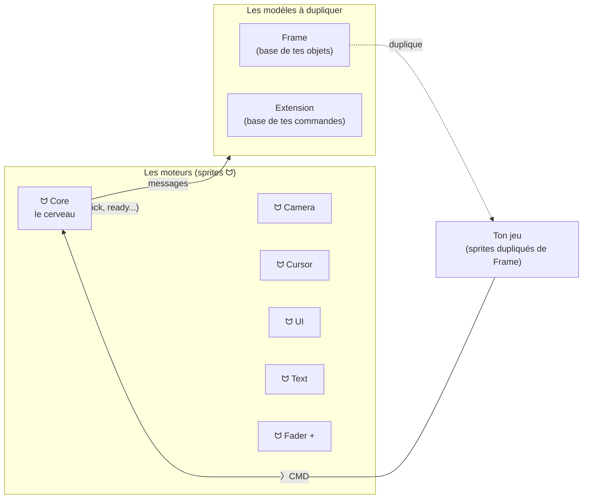

# 🐱 Catlib v7

> **Une énorme boîte à outils pour créer des jeux Scratch beaucoup plus vite, sans tout recoder à chaque fois.**

Catlib est un **framework** pour **Scratch 3 / TurboWarp** : un gros projet déjà rempli de code que tu réutilises comme point de départ. Au lieu de refaire encore une caméra, des boutons, un système de sauvegarde ou un affichage de texte, tu récupères des blocs tout prêts.

C'est l'outil qui a servi à fabriquer **Again V3** et **Deadzone**.

> [!NOTE]
> Au début, Catlib peut paraître impressionnant et demande un peu de temps pour être pris en main. Mais une fois qu'on a compris le principe (et c'est le but de cette documentation 😉), il change vraiment la façon de coder et d'animer sur Scratch.

---

## 🧰 Ce qu'il y a dans la boîte

| Fonctionnalité | À quoi ça sert | Chapitre |
|---|---|---|
| 🎬 **Caméra** | Une caméra qui suit tes sprites, zoome et tourne | [05 · Caméra](docs/05-camera.md) |
| 🏃 **Mouvements fluides** | Blocs `smooth` et `bounce`, animations qui réagissent à la souris | [04 · Mouvements et effets](docs/04-mouvements-effets.md) |
| 🖱️ **Curseur** | Un curseur personnalisé avec événements survol / clic | [06 · Curseur](docs/06-curseur.md) |
| 🧱 **UI Builder** | Créer menus et boutons interactifs | [07 · UI](docs/07-ui.md) |
| 🔤 **Moteur de texte** | Afficher du texte avec une police intégrée, alignement, effets d'écran | [08 · Texte](docs/08-texte.md) |
| 🎞️ **Système de scènes** | Organiser menus et écrans de jeu proprement, avec fondus | [09 · Scènes et fondus](docs/09-scenes-fondus.md) |
| 📡 **Commandes inter-sprites** | Tous les sprites se parlent grâce à un seul bloc `〉CMD` | [10 · Commandes et modules](docs/10-commandes-modules.md) |
| 💾 **Données et sauvegardes** | Un bloc `〉DATA` pour stocker / lire / sauvegarder | [11 · Données et sauvegardes](docs/11-donnees-sauvegardes.md) |
| 🔐 **Générateur de codes de sauvegarde** | Codes de sauvegarde pour tes joueurs en un clin d'œil | [11 · Données et sauvegardes](docs/11-donnees-sauvegardes.md#4-les-codes-de-sauvegarde-safe-code) |
| 💻 **Terminal intégré** | Une console de debug dans ton jeu (touche `&`) | [12 · Terminal](docs/12-terminal.md) |
| ⌨️ **Clavier, souris, son** | Touches pressées, volumes musique / effets | [13 · Son, clavier, temps](docs/13-son-clavier-temps.md) |
| 🛠️ **Blocs TOOLS** | Petits utilitaires : distance, angle, collisions, texte… | [14 · Outils TOOLS](docs/14-tools.md) |

---

## ⚡ Démarrage express (5 minutes)

1. **Ouvre** `Catlib_v7.sb3` dans [TurboWarp](https://turbowarp.org/) (conseillé) ou dans Scratch.
2. **Clique sur le drapeau vert** 🏁. Tu verras l'intro, puis la scène `MENU`.
3. **Appuie sur la touche `&`** : le terminal s'ouvre. Tape `HELP` puis `Entrée`.
4. **Fais ton premier objet** : clic droit sur le sprite **`Frame`** → *dupliquer*, puis suis la recette [« Mon premier objet »](docs/15-recettes.md#recette-1--mon-premier-objet).
5. Lis ensuite [02 · Comment ça marche](docs/02-fonctionnement.md) : c'est le chapitre qui rend tout le reste facile.

---

## 📚 Sommaire de la documentation

### 🟢 Pour commencer
- [01 · Démarrage](docs/01-demarrage.md) — installer, découvrir le projet, premier lancement
- [02 · Comment ça marche](docs/02-fonctionnement.md) — le cerveau de Catlib expliqué simplement
- [15 · Recettes pas à pas](docs/15-recettes.md) — des mini-tutoriels à copier

### 🟡 Les outils, un par un
- [03 · Le sprite Frame](docs/03-frame.md) — la base de tous tes objets
- [04 · Mouvements et effets](docs/04-mouvements-effets.md) — `MOVE`, `SIZE`, `ROTATE`, `FX`
- [05 · Caméra](docs/05-camera.md)
- [06 · Curseur](docs/06-curseur.md)
- [07 · UI Builder](docs/07-ui.md)
- [08 · Moteur de texte](docs/08-texte.md)
- [09 · Scènes et fondus](docs/09-scenes-fondus.md)
- [10 · Commandes et modules](docs/10-commandes-modules.md) — dont comment créer **tes propres commandes**
- [11 · Données et sauvegardes](docs/11-donnees-sauvegardes.md)
- [12 · Terminal](docs/12-terminal.md)
- [13 · Son, clavier, temps](docs/13-son-clavier-temps.md)
- [14 · Outils TOOLS](docs/14-tools.md)

### 🔴 Référence et aide
- [16 · Référence rapide](docs/16-reference-rapide.md) — la liste de tous les blocs
- [17 · Dépannage et limites connues](docs/17-depannage.md)
- [18 · Glossaire et historique des versions](docs/18-glossaire-versions.md)

---

## 🗺️ Le projet en une image

---

## ✅ Compatibilité

- Projet enregistré avec **TurboWarp** (on le voit à son commentaire de configuration `_twconfig_`). C'est l'endroit le plus sûr pour l'utiliser.
- Il utilise l'extension **Stylo** (*Pen*) de Scratch.
- La variable cloud (`☁ 〉CLOUD global`) ne fonctionne que sur le site officiel de Scratch, avec un compte connecté.

> [!IMPORTANT]
> Cette documentation a été écrite en **lisant le code du projet** (sprites, blocs personnalisés, listes, commentaires). Les points qui m'ont semblé surprenants sont regroupés dans [17 · Dépannage et limites connues](docs/17-depannage.md).

## 👤 Crédits

Catlib v7 — *auteur·rice : à compléter*.
