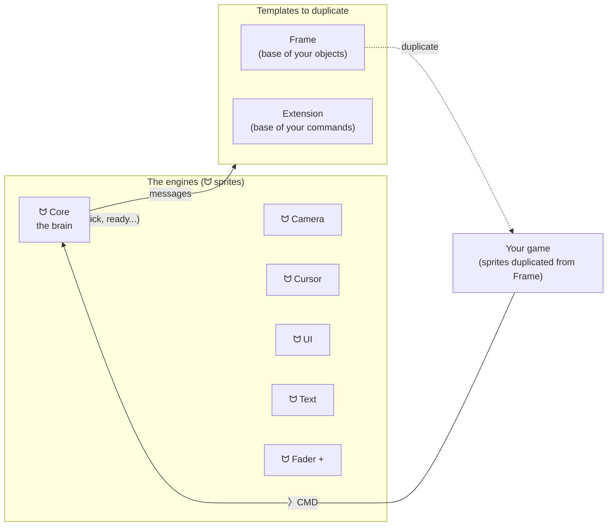

# 🐱 Catlib v7

> **A huge toolbox to build Scratch games much faster, without recoding everything from scratch every time.**

Catlib is a **framework** for **Scratch 3 / TurboWarp**: a big project already full of code that you reuse as a starting point. Instead of rebuilding a camera, buttons, a save system or text display again and again, you get ready-made blocks.

It is the exact tool used to build **Again V3** and **Deadzone**.

> [!NOTE]
> At first, Catlib can feel a bit overwhelming and takes some time to get used to. But once you understand the principle (and that is the goal of this documentation 😉), it really changes how you code and animate in Scratch.

---

## 🧰 What's in the box

| Feature | What it's for | Chapter |
|---|---|---|
| 🎬 **Camera** | A camera that follows your sprites, zooms and rotates | [05 · Camera](<docs/05 · Camera.md>) |
| 🏃 **Smooth movement** | `smooth` and `bounce` blocks, animations that react to the mouse | [04 · Movement and effects](<docs/04 · Movement Effects.md>) |
| 🖱️ **Cursor** | A custom cursor with hover / click events | [06 · Cursor](<docs/06 · Cursor.md>) |
| 🧱 **UI Builder** | Build menus and interactive buttons | [07 · UI](<docs/07 · UI.md>) |
| 🔤 **Text engine** | Display text with a built-in font, alignment, screen effects | [08 · Text](<docs/08 · Text.md>) |
| 🎞️ **Scene system** | Organize menus and game screens cleanly, with fades | [09 · Scenes and fades](<docs/09 · Scenes and Fades.md>) |
| 📡 **Inter-sprite commands** | All sprites talk to each other with a single `〉CMD` block | [10 · Commands and modules](<docs/10 · Commands and Modules.md>) |
| 💾 **Data and saves** | A `〉DATA` block to store / read / save | [11 · Data and saves](<docs/11 · Data and Save Files.md>) |
| 🔐 **Save code generator** | Generate save codes for your players in one call | [11 · Data and saves](<docs/11 · Data and Save Files.md#4-save-codes-safe-code>) |
| 💻 **Built-in terminal** | A debug console inside your game (`&` key) | [12 · Terminal](<docs/12 · The Built-in Terminal.md>) |
| ⌨️ **Keyboard, mouse, sound** | Pressed keys, music / effects volumes | [13 · Sound, keyboard, time](<docs/13 · Sound, Keyboard, Mouse, and Time.md>) |
| 🛠️ **TOOLS blocks** | Handy utilities: distance, angle, collisions, text… | [14 · TOOLS](<docs/14 · The TOOLS Blocks.md>) |

---

## ⚡ Quick start (5 minutes)

1. **Open** `Catlib_v7.sb3` in [TurboWarp](https://turbowarp.org/) (recommended) or in Scratch.
2. **Click the green flag** 🏁. You'll see the intro, then the `MENU` scene.
3. **Press the `&` key**: the terminal opens. Type `HELP` then `Enter`.
4. **Make your first object**: right-click the **`Frame`** sprite → *duplicate*, then follow the recipe ["My first object"](<docs/15 · Step-by-Step Recipes.md#recipe-1-my-first-object>).
5. Then read [02 · How it works](<docs/02 · How it works.md>): it's the chapter that makes everything else easy.

---

## 📚 Documentation index

### 🟢 Getting started
- [01 · Getting started](<docs/01 · Getting started.md>) — install, discover the project, first launch
- [02 · How it works](<docs/02 · How it works.md>) — the brain of Catlib explained simply
- [15 · Step-by-step recipes](<docs/15 · Step-by-Step Recipes.md>) — mini-tutorials to copy

### 🟡 The tools, one by one
- [03 · The Frame sprite](<docs/03 · Frame.md>) — the base of all your objects
- [04 · Movement and effects](<docs/04 · Movement Effects.md>) — `MOVE`, `SIZE`, `ROTATE`, `FX`
- [05 · Camera](<docs/05 · Camera.md>)
- [06 · Cursor](<docs/06 · Cursor.md>)
- [07 · UI Builder](<docs/07 · UI.md>)
- [08 · Text engine](<docs/08 · Text.md>)
- [09 · Scenes and fades](<docs/09 · Scenes and Fades.md>)
- [10 · Commands and modules](<docs/10 · Commands and Modules.md>) — including how to create **your own commands**
- [11 · Data and saves](<docs/11 · Data and Save Files.md>)
- [12 · Terminal](<docs/12 · The Built-in Terminal.md>)
- [13 · Sound, keyboard, time](<docs/13 · Sound, Keyboard, Mouse, and Time.md>)
- [14 · TOOLS](<docs/14 · The TOOLS Blocks.md>)

### 🔴 Reference and help
- [16 · Quick reference](<docs/16 · Quick Reference.md>) — the list of all blocks
- [17 · Troubleshooting and known limitations](<docs/17 · Troubleshooting and Known Limitations.md>)

---

## 🗺️ The project in one picture

---

## ✅ Compatibility

- The project was saved with **TurboWarp**. It is the safest place to use it.
- It uses the Scratch **Pen** extension.
- The cloud variable (`☁ 〉CLOUD global`) only works on the official Scratch website, with a logged-in account (if they are not down).

> [!IMPORTANT]
> This documentation was written by **reading the project's code** (sprites, custom blocks, lists, comments). Points that looked surprising are gathered in [17 · Troubleshooting and known limitations](<docs/17 · Troubleshooting and Known Limitations.md>).

## 👤 Credits

Catlib v7 — -pAc-.
