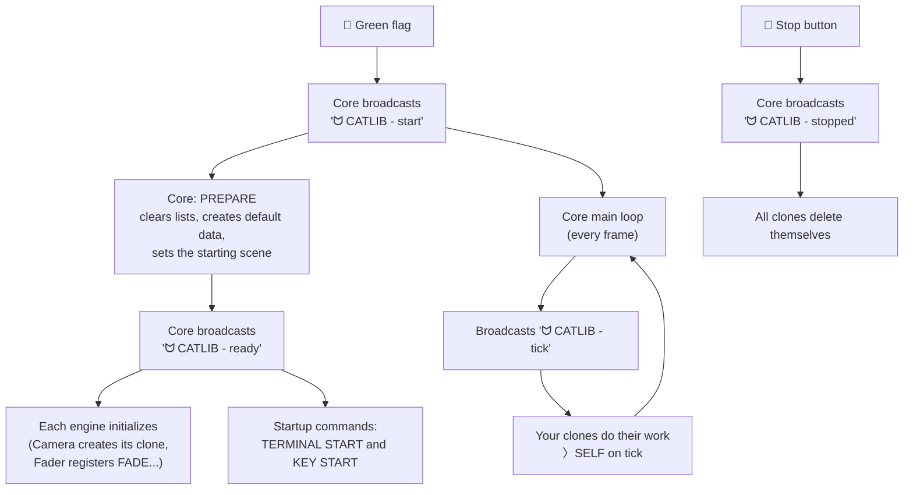
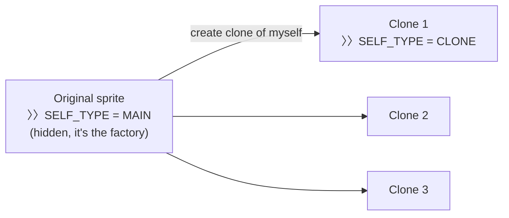
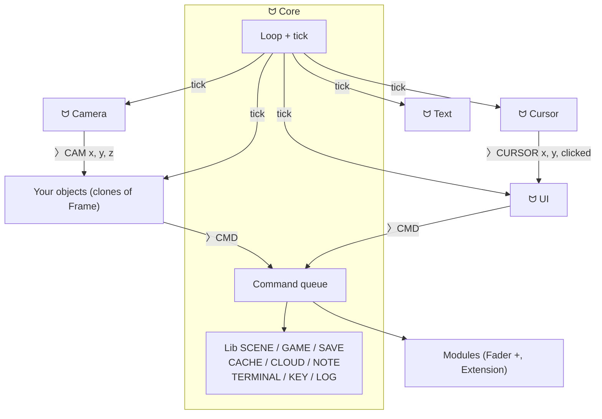

# 02 · How it works

> **Goal:** understand Catlib's "brain". Once you've read this chapter, everything else becomes logical. Take your time: it's the most important chapter.

⬅️ [Getting started](01-getting-started.md) · [Index](../README.md) · ➡️ [The Frame sprite](03-frame.md)

---

## 1. The three ideas to remember

Catlib relies on **three simple ideas**:

1. 📣 **Messages**: `ᗢ Core` shouts messages ("let's go!", "new frame!") and every sprite listens.
2. 👯 **Clones**: every object in the game is a **clone**. The original sprite only exists to make them.
3. 📋 **Lists**: data (saves, commands, scenes…) is stored in global **lists**.

## 2. The life cycle: from green flag to stop



### The "heartbeat": the `tick`

Every frame (≈ 30 times per second in Scratch), `ᗢ Core` broadcasts the message **`ᗢ CATLIB - tick`**. It's the game's heartbeat. Every clone that hears it runs its `〉SELF on tick` block: *that's where you put everything that must happen continuously* (movement, animation, checks…).

> [!TIP]
> In a classic Scratch project you put a `forever` loop in each sprite. With Catlib, **you almost never do**: the `tick` plays that role and everyone stays in sync.

### What Core's main loop does every frame

| Step | Effect |
|---|---|
| 1. If commands are waiting | Creates **one clone** of Core that runs **one** command (see [10 · Commands](10-commands-modules.md)). |
| 2. `reset timer` | Used to **detect the stop button** (see below). |
| 3. `erase all` (pen) | Clears the previous frame's drawing. |
| 4. `ᗢ CORE pack layers` | Updates the display order of objects. |
| 5. `Func - DATE` and `Func - TIME` | Update `〉TIME date` and `〉TIME clock`. |

A **second loop** broadcasts `ᗢ CATLIB - tick` and adds `0.1` to the variable `ᗢ CLOCK` (an internal clock used for unique IDs and the text cursor blinking).

> [!WARNING]
> **The pen is cleared every frame.** If you draw with the pen yourself, your drawing will vanish immediately. Catlib uses the pen (via "stamping") to display objects: that's what allows many elements without slowing down. See [03 · Frame, stamp mode](03-frame.md#4-stamp-mode).

### How Catlib detects the stop button

Scratch doesn't tell you when stop is pressed. Catlib uses a trick: the timer is reset **every frame** by Core's loop. When you press stop, the loop ends, the timer starts climbing, and the `when timer > 0` hat fires. It calls `Config - ON STOP`, which broadcasts **`ᗢ CATLIB - stopped`**. All clones listen to it and delete themselves: no ghost clones after stopping.

## 3. Catlib's messages

| Message | Sent by | When | What you do with it |
|---|---|---|---|
| `ᗢ CATLIB - start` | Core | Green flag | Nothing (Core uses it). |
| `ᗢ CATLIB - ready` | Core | Everything initialized | Reset variables at startup. |
| `ᗢ CATLIB - tick` | Core | **Every frame** | Make clones live (already wired in `Frame`). |
| `ᗢ CATLIB - vol changed` | You send it | After a volume change | Sprites re-apply their volume (already wired). |
| `ᗢ CATLIB - stopped` | Core | Stop button | Clones delete themselves (already wired). |
| `ᗢ CATLIB - first start` | Core | New user detected | Launch a tutorial, an intro… |
| `ᗢ SCENE new` | Core | On every scene change | React to any change. |
| `ᗢ SCENE back` | Core | Back to previous scene | Same. |
| `SCENE <NAME>` | Core | Entering scene `<NAME>` | **Create the objects of that scene.** |
| `SCENE <NAME> STOP` | Core | Scene change | See [09 · Scenes](09-scenes-fades.md#careful-the-stop-message). |
| `INTRO fade` | INTRO V12 | End of logo | Only used by the intro. |

> [!NOTE]
> Another message, `ᗢ - CATLIB init`, exists in the project but **no script uses it**.

## 4. Original sprite and clones

All sprites based on `Frame` work the same way:



- The **original sprite** has the variable `〉〉SELF_TYPE = MAIN`. It's hidden, and it receives `ᗢ CATLIB - ready` to reset its variables.
- Each **clone** has `〉〉SELF_TYPE = CLONE`. Only then does it get a unique ID, a layer, and play its `〉SELF on tick`.

> [!TIP]
> "For this sprite only" variables (`〉SELF x`, `〉SELF y`, `〉FX ghost`…) are **per clone**. Each object therefore has its own position, size and effects.

## 5. The "I prepare, then I draw" principle

In Catlib, an object **doesn't move directly** with `go to x: y:`. It works in two steps:

```text
1) COMPUTE : the 〉MOVE / 〉SIZE / 〉ROTATE / 〉FX blocks modify variables
              (〉SELF x, 〉SELF y, 〉SELF size, 〉SELF rotation, 〉FX ghost…)
2) APPLY   : 〉UPDATE normal  (or 〉UPDATE camera)  copies these variables
              onto the real on-screen sprite.
```

That's what lets you add the camera, layers or zoom **without changing your logic**: just replace `〉UPDATE normal` with `〉UPDATE camera`.

## 6. Global variables and lists

**Global** variables and lists (visible to all sprites) live on the Stage. Here are the most important ones:

### Variables

| Variable | Contains |
|---|---|
| `〉SCENE` | The current scene name (`MENU`, `GAME`…). |
| `〉TIME clock` | The time `HH:MM` (the colon blinks every second). |
| `〉TIME date` | The date in `MM/DD/YYYY` format. |
| `〉CAM x`, `〉CAM y`, `〉CAM z`, `〉CAM rotation` | The camera's position, zoom and rotation. |
| `〉CURSOR x`, `〉CURSOR y` | The mouse position. |
| `〉CURSOR clicked ?` | `YES` or `NO`: is the mouse button down? |
| `〉CURSOR hovering ?` | `YES` or `NO`: is the cursor over a button? |
| `〉USER` | The last Scratch username seen (detects the first start). |
| `☁ 〉CLOUD global` | The cloud variable. |

### Lists

| List | Contains |
|---|---|
| `ᗢ DATA game` / `save` / `cache` / `cloud` | The 4 data spaces ([chapter 11](11-data-saves.md)). |
| `〉SAVECODES` | The latest generated save codes. |
| `〉PRESSED KEY` | The keys currently held down. |
| `ᗢ CORE cmd` / `stack` | The command queue. |
| `ᗢ CORE scenes` | The scene history. |
| `ᗢ CORE layers order` / `layers` | The display order of objects. |
| `〉LOGS` | The log of `LOG` messages. |

## 7. Naming conventions

| Prefix | Meaning |
|---|---|
| `〉` | Block or variable **meant for the user**. |
| `〉〉` | Global variable specific to a `Frame` sprite (e.g. `〉〉UNIQUE_ID`, `〉〉SELF_TYPE`). |
| `ᗢ CORE` | **Internal**: Catlib's gears. |
| `Config - …` | **Configuration** blocks in `ᗢ Core`. |
| `Lib - …` | `ᗢ Core`'s command "libraries" (`Lib - SCENE`, `Lib - SAVE`…). |
| `Func - …` | Internal functions of `ᗢ Core`. |

## 8. Overview diagram: who talks to whom?



---

⬅️ [Getting started](01-getting-started.md) · [Index](../README.md) · ➡️ [The Frame sprite](03-frame.md)
