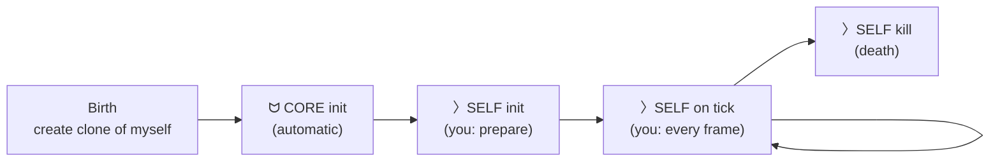

# 03 · The Frame sprite

> **Goal:** know how to build any object in your game (character, scenery, enemy, button…) from the **`Frame`** sprite.

⬅️ [How it works](02-how-it-works.md) · [Index](../README.md) · ➡️ [Movement and effects](04-movement-effects.md)

---

## 1. What is Frame for?

`Frame` is the **base engine**: it already contains everything an object needs to be compatible with Catlib (camera, layers, effects, sounds, commands, tools…).

> The comment attached to `Frame` says it: **"DUPLICATE THIS SPRITE. This is the base sprite you need to use as a starting point to be able to use Catlib's features."**

You **never** modify `Frame` itself: you **duplicate** it (right-click → *duplicate*) and work on the copy.

> [!TIP]
> The **`DEMO`** sprite is a copy of `Frame` with **explanatory comments**. Read it to understand each block, then duplicate `Frame` to work.

## 2. The 4 lives of an object



### Birth: `create clone of myself`

To make an object appear, you create a clone of the sprite. An object only exists when you create it:

```text
when I receive [SCENE GAME]
create clone of [myself]
```

### Automatic initialization: `ᗢ CORE init`

As soon as a clone is born, `Frame` runs `ᗢ CORE init` (**don't modify it**). In order, it:

1. Creates a **unique identifier** (`〉〉UNIQUE_ID`, for example `4bwmakn04u-3ilxn1da3z-141`).
2. Sets `〉〉SOUND_SOURCE` to `SFX`, `〉〉CLONE_TYPE` to `FRAME`, `〉〉SELF_TYPE` to `CLONE`.
3. Remembers the **original values** (`〉SELF x origine`, `〉SELF y origine`, `〉SELF size origine`, `〉SELF sprite origine`).
4. Registers the object in the layers list.
5. Sets the ghost effect to 100 (**invisible**) and hides the sprite.
6. Calls **`〉SELF init`**, then **`〉SELF on tick`** once.

### Preparation: `〉SELF init` (you)

> *"Use this to prepare instance before it get rendered."* — `DEMO` comment

This is where you set the **starting point**: position, size, layer, costume, effects. In `Frame`, this block contains by default:

```text
〉MOVE set / xy [0] [0]
〉SIZE set / val [40]
〉SELF set layer / layer [100]
〉FX ghost / val [100] speed [1]
show
```

> [!WARNING]
> **Your object is invisible by default**: `〉FX ghost val 100` means "100% ghost". To make it appear, use for example `〉FX ghost / val [0] speed [5]` (smooth fade-in) in `〉SELF init` or `〉SELF on tick`.

### Every frame: `〉SELF on tick` (you)

This is your object **loop**. It's called on every `ᗢ CATLIB - tick`, **for clones only**. By default:

```text
〉UPDATE normal
```

You add your movements, effects, conditions. **Important rule: `〉UPDATE normal` (or `〉UPDATE camera`) must stay at the end**, because it's what applies everything on screen (see below).

### Death: `〉SELF kill`

> *"Don't use [delete this clone] to kill an instance. USE THIS → [〉SELF kill]"* — `DEMO` comment

`〉SELF kill` removes the object from the layers list **before** deleting the clone. If you delete a clone without it, the layers list keeps a "ghost" and the display order gets messed up. It's also the block called automatically when the project stops.

## 3. Applying to the screen: `〉UPDATE`

The `〉MOVE`, `〉SIZE`, `〉ROTATE` blocks **don't** move the sprite: they modify variables (`〉SELF x`, `〉SELF y`, `〉SELF size`, `〉SELF rotation`). `〉UPDATE` **applies** them to the real sprite.

| Block | Role |
|---|---|
| `〉UPDATE normal` | **Normal** mode: the object behaves as usual. It's not affected by the camera (ideal for the interface). |
| `〉UPDATE camera / origine [ORIGINE] mirror [SIDE]` | **Camera** mode: the object is tied to the camera (position, zoom, rotation). See [05 · Camera](05-camera.md). |

Both blocks also update the layer (`ᗢ CORE update plan`) and the size (`ᗢ CORE size instant`, which lets you exceed Scratch's size limit by going through an empty `_BLANK` costume).

> [!NOTE]
> A rotation of `0` means "upright": Catlib does `point in direction (rotation + 90)` for you. A positive rotation turns clockwise.

## 4. Stamp mode

> *"STAMP: When used the sprite will only be rendered with stamp."* — `DEMO` comment

With `〉SELF stamp`, instead of displaying the real sprite, Catlib **stamps** it with the pen then makes it **invisible** (ghost 100). The remaining image comes from the pen, which Core **clears every frame**.

```text
when I receive [ᗢ CATLIB - tick]  →  〉SELF on tick :
    …your movements…
    〉UPDATE normal
    〉SELF stamp
```

**Advantages:** lots of elements (like text letters) without slowing down, and the ghost / brightness effect applies to the stamp.
**Good to know:** the stamp must be redone **every frame**, otherwise the object disappears on the next one. That's what Catlib's cursor, UI and text use.

## 5. Layers (display order)

Which object goes in front of which? That's the role of:

```text
〉SELF set layer / layer [LAYER]
```

> *"5 - 10000. The bigger, the more in front."* — `DEMO` comment

| Value | Effect |
|---|---|
| a number (e.g. `100`) | The **bigger** the number, the more **in front** the object. |
| `TOP` | Frontmost. |
| `BOTTOM` | Backmost. |

The variable `〉SELF layer` tells you the object's current position.

> [!TIP]
> Give your objects **different**, evenly spaced values (scenery `10`, characters `100`, effects `500`, interface `1000`). That leaves room to insert more layers later.

> [!NOTE]
> According to the code, the layers list is extended up to the requested number (empty slots are added). So avoid needlessly huge values.

## 6. What Frame gives you

Every sprite duplicated from `Frame` gets the following **for free**:

| Family | Blocks | Chapter |
|---|---|---|
| Movement | `〉MOVE set / smooth / bounce / add`, `〉MOVE+ parallax` | [04](04-movement-effects.md) |
| Size | `〉SIZE set / smooth / bounce / add`, `〉SIZE+ mouse speed` | [04](04-movement-effects.md) |
| Rotation | `〉ROTATE set / smooth / bounce / add`, `〉ROTATE+ mouse speed` | [04](04-movement-effects.md) |
| Effects | `〉FX ghost / bright / color / fisheye / pixalate / whirl` | [04](04-movement-effects.md) |
| Rendering | `〉UPDATE normal`, `〉UPDATE camera`, `〉SELF stamp`, `〉SELF set layer` | this chapter + [05](05-camera.md) |
| Data | `〉DATA / source action var to` | [11](11-data-saves.md) |
| Commands | `〉CMD / name option args…` | [10](10-commands-modules.md) |
| Sound | `〉SOUND play`, `〉SOUND stop` | [13](13-sound-keyboard-time.md) |
| Tools | `〉TOOL …` (distance, angle, collision, text…) | [14](14-tools.md) |

### Each object's variables

| Variable | Role |
|---|---|
| `〉SELF x`, `〉SELF y` | Wanted position. |
| `〉SELF size` | Wanted size (in %). |
| `〉SELF rotation` | Wanted rotation (in degrees). |
| `〉SELF layer` | Position in the layers. |
| `〉SELF x origine`, `y origine`, `size origine`, `sprite origine` | Values at birth. |
| `〉FX ghost`, `bright`, `color`, `fisheye`, `pixel`, `whirl` | Current effect values. |
| `〉〉UNIQUE_ID` | The clone's unique identifier. |
| `〉〉SELF_TYPE` | `MAIN` (original sprite) or `CLONE`. |
| `〉〉CLONE_TYPE` | Object type (`FRAME` by default). |
| `〉〉SOUND_SOURCE` | Sound channel (`SFX` by default, or `MUSIC`…). |

## 7. The example script in Frame (delete it!)

`Frame` and `DEMO` each contain a small **example** script:

```text
when I start as a clone
forever
    〉MOVE bounce / xy [0] [0] damp [2] bounciness [2]
    〉SIZE bounce / val [40] damp [2] bounce [2]
```

It brings the object back to the center with a bouncy effect. It's great to **see** how it works, but **delete it in your own sprites**, otherwise each of your clones will be pulled back to the center permanently!

## 8. Checklist: creating an object

1. ✅ Duplicate `Frame`, rename the copy.
2. ✅ Add your **costumes** (keep `Icon` and `_BLANK`, used by Catlib).
3. ✅ **Delete** the example script (§7).
4. ✅ Fill in `〉SELF init` (position, size, layer, appearance).
5. ✅ Fill in `〉SELF on tick` (logic), keeping `〉UPDATE normal` at the end.
6. ✅ Create the object when needed: `create clone of myself`.
7. ✅ Remove it with `〉SELF kill`.

👉 A full example: [Recipe 1: My first object](15-recipes.md#recipe-1--my-first-object).

---

⬅️ [How it works](02-how-it-works.md) · [Index](../README.md) · ➡️ [Movement and effects](04-movement-effects.md)
