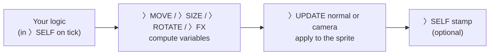

# 04 · Movement and effects

> **Goal:** animate your objects smoothly (glide, bounce, grow, rotate) and apply visual effects, with the `〉MOVE`, `〉SIZE`, `〉ROTATE` and `〉FX` blocks.

⬅️ [Frame](03-frame.md) · [Index](../README.md) · ➡️ [Camera](05-camera.md)

---

## 1. The principle: aim for a target

All these blocks work the same way: you give **where you want to go** (the target), and the block moves the object **a bit closer** to the target **on each call**. Called every frame in `〉SELF on tick`, they create a smooth animation.

```text
〉SELF on tick :
    〉MOVE smooth / xy [100] [50] damp [8]
    〉UPDATE normal
```

> [!WARNING]
> These blocks only take **one small step at a time**. So you must **call them every tick** (in `〉SELF on tick`), not just once.

## 2. The 4 "ways to move"

For each quantity (position, size, rotation), there's the same family of blocks:

| Block | Behavior | When to use it |
|---|---|---|
| **`set`** | **Instant**: the object jumps to the value. | Placing an object at the start. |
| **`smooth`** | **Glides** toward the target, slowing down on arrival. | Soft movements. |
| **`bounce`** | Goes toward the target as if **attached to a spring**: overshoots, comes back, settles. | Buttons, menus, "alive" effects. |
| **`add`** | **Adds** a value to the current one. | Relative movement (+2 every frame). |

### `smooth`: `〉MOVE smooth / xy [X] [Y] damp [DAMP]`

On each call, the object covers `1/DAMP` of the distance separating it from the target.

| `damp` | Effect |
|---|---|
| `1` | Instant (exactly what `set` does). |
| `2` to `5` | Fast. |
| `8` to `20` | Slow and soft (camera, following). |

### `bounce`: `〉MOVE bounce / xy [X] [Y] damp [DAMP] bounciness [BOUNCE]`

Here, the object has a **speed** that is added to its position. Each frame:

```text
speed = speed / BOUNCE  +  (target − position) / DAMP
position = position + speed
```

| Parameter | Role | Tip |
|---|---|---|
| `damp` | Strength of the "spring": the **smaller**, the harder the object is pulled. | Start with `2`. |
| `bounciness` | How much speed is kept from one frame to the next. | **Counter-intuitive:** the closer the value to `1`, the longer it bounces. With `2`, motion damps quickly. Below `1`, it becomes unstable. |

> [!TIP]
> `damp = 2` and `bounciness = 2` are the values used by Catlib's cursor and buttons: they're good starting settings.

## 3. Movement: `〉MOVE`

| Block | Role |
|---|---|
| `〉MOVE set / xy [X] [Y]` | Places the object **immediately**. |
| `〉MOVE smooth / xy [X] [Y] damp [DAMP]` | Glides toward `(X ; Y)`. |
| `〉MOVE bounce / xy [X] [Y] damp [DAMP] bounciness [BOUNCE]` | Bounces toward `(X ; Y)`. |
| `〉MOVE add / xy [X] [Y]` | Adds `X` and `Y` to the position. |
| `〉MOVE+ parallax / damp [DAMP] for [X/Y]` | Makes the object **react to the mouse** (see §6). |

> [!TIP]
> **Leaving a slot empty** means "don't touch that axis". `〉MOVE smooth / xy [] [50] damp [5]` only modifies `y`. Useful to control just one axis (for example, a character moving left/right whose height is handled elsewhere).

## 4. Size: `〉SIZE`

| Block | Role |
|---|---|
| `〉SIZE set / val [VALUE]` | Immediate size (in %). |
| `〉SIZE smooth / val [VALUE] damp [DAMP]` | Grows / shrinks smoothly. |
| `〉SIZE bounce / val [VALUE] damp [DAMP] bounce [BOUNCE]` | "Spring" effect on size (a pulsing button). |
| `〉SIZE add / val [VAL]` | Adds to the size. |
| `〉SIZE+ mouse speed / damp [DAMP]` | Size reacts to the **mouse speed** (see §6). |

## 5. Rotation: `〉ROTATE`

| Block | Role |
|---|---|
| `〉ROTATE set / val [VAL]` | Immediate rotation (degrees). |
| `〉ROTATE smooth / val [VALUE] damp [DAMP]` | Rotates smoothly. |
| `〉ROTATE bounce / val [VALUE] damp [DAMP] bounce [BOUNCE]` | Rotates with a spring effect. |
| `〉ROTATE add / val [VALUE]` | Adds degrees (e.g. `+2` every frame = spinning top). |
| `〉ROTATE+ mouse speed / damp [DAMP] mirror [MIRROR]` | Rotation reacts to the **mouse speed** (see §6). |

## 6. Animations that react to the mouse

Three "`+`" blocks add an **offset** computed from the mouse. Place them **before** the matching `smooth` / `bounce`.

| Block | Formula | Effect |
|---|---|---|
| `〉MOVE+ parallax / damp [DAMP] for [X/Y]` | offset = `〉CURSOR x` ÷ `damp` (and/or `y`) | The object moves **opposite** to the mouse: depth effect. `for`: `X`, `Y` or `XY`. |
| `〉SIZE+ mouse speed / damp [DAMP]` | offset = `abs(〉CURSOR speed x)` ÷ `damp` × zoom | Size increases when the mouse moves fast. |
| `〉ROTATE+ mouse speed / damp [DAMP] mirror [MIRROR]` | offset = `〉CURSOR speed x` × `mirror` ÷ `damp` × zoom | The object tilts with the mouse's horizontal speed. `mirror`: `1` or `-1` to choose the direction. |

**Example: a logo that moves with the mouse**

```text
〉SELF on tick :
    〉MOVE+ parallax / damp [40] for [XY]
    〉MOVE bounce / xy [0] [0] damp [2] bounciness [2]
    〉UPDATE normal
```

> [!WARNING]
> `〉SIZE+ mouse speed` and `〉ROTATE+ mouse speed` read the variable **`〉CURSOR speed x`**. In the provided file, **no script updates this variable**: it stays at `0`, so these two effects do nothing until you feed it. Simple fix in [06 · Cursor](06-cursor.md#5-feeding-the-mouse-speed). `〉MOVE+ parallax`, on the other hand, works right away (it uses `〉CURSOR x` and `〉CURSOR y`, which are properly updated).

> [!NOTE]
> Each family internally keeps its own "speed" (one variable per axis). **Don't use `smooth` and `bounce` at the same time on the same quantity** in one object: they would fight each other.

## 7. Visual effects: `〉FX`

Same "glide toward a target" principle, but for Scratch's graphic effects:

```text
〉FX ghost / val [VALUE] speed [SPEED]
```

| Block | Scratch effect | Useful range |
|---|---|---|
| `〉FX ghost` | ghost (transparency) | `0` = visible, `100` = invisible |
| `〉FX bright` | brightness | `-100` to `100` |
| `〉FX color` | color (hue) | `0` to `200` (loops) |
| `〉FX fisheye` | fisheye | positive values = distortion |
| `〉FX pixalate` | pixelate | `0` and up |
| `〉FX whirl` | whirl | positive or negative |

`speed` plays the same role as `damp`: `1` = immediately, bigger = slower.

**Examples**

```text
〉FX ghost / val [0] speed [5]        ← fade in
〉FX ghost / val [100] speed [5]      ← fade out
〉FX bright / val [30] speed [1]      ← brighten at once
```

> [!NOTE]
> Current values are stored in `〉FX ghost`, `〉FX bright`, `〉FX color`, `〉FX fisheye`, `〉FX pixel` and `〉FX whirl`, **per clone**. In stamp mode, call your `〉FX` **before** `〉SELF stamp`.

## 8. Visual summary



---

⬅️ [Frame](03-frame.md) · [Index](../README.md) · ➡️ [Camera](05-camera.md)
