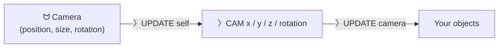

# 05 · Camera

> **Goal:** move, zoom and rotate the game's "camera", and make your objects follow it.

⬅️ [Movement and effects](04-movement-effects.md) · [Index](../README.md) · ➡️ [Cursor](06-cursor.md)

---

## 1. The principle

Scratch has no real camera. Catlib simulates one: instead of moving the camera, it **moves all objects the opposite way**, with a bit of math. You don't have to do that math.

There are three actors:

| Actor | Role |
|---|---|
| The **`ᗢ Camera`** sprite | A sprite built like `Frame`. Its position, size and rotation **are** the camera's. |
| The variables **`〉CAM x`, `〉CAM y`, `〉CAM z`, `〉CAM rotation`** | The camera's values, readable by everyone. |
| The **`〉UPDATE camera`** block | Used by your objects to **obey** the camera. |



In `ᗢ Camera`, the `〉UPDATE self` block does: `〉CAM x = 〉SELF x`, `〉CAM y = 〉SELF y`, `〉CAM rotation = 〉SELF rotation`, `〉CAM z = 〉SELF size ÷ 100`.

> **Zoom:** the camera's size is its zoom. Size `100` = zoom ×1 (normal), `200` = ×2 (everything twice as big).

## 2. Moving the camera: the `UPADTE CAM` block

> *"HERE you can change the camera position. IF your sprites use the UPDATE CAMERA block they will move as the camera moves."* — comment in `ᗢ Camera`

In `ᗢ Camera`, find the block **`UPADTE CAM`** (yes, with that typo: keep the name as is). It runs **every frame** and by default contains:

```text
DEFINE UPADTE CAM
    〉SIZE set / val [100]
    〉MOVE set / xy [0] [0]
```

= fixed camera at the center, normal zoom. **This is where you put your camera logic**, using the same blocks as for any object (see [04](04-movement-effects.md)).

### Example: smoothly following a player

```text
DEFINE UPADTE CAM
    〉SIZE set / val [100]
    〉MOVE bounce / xy [(x position) of [Player]] [(y position) of [Player]] damp [8] bounciness [2]
```

### Example: zoom with a key

```text
DEFINE UPADTE CAM
    if <key [up arrow] pressed?> then
        〉SIZE smooth / val [150] damp [10]
    else
        〉SIZE smooth / val [100] damp [10]
    〉MOVE set / xy [0] [0]
```

### Example: slight rotation

```text
    〉ROTATE smooth / val [10] damp [20]
```

> [!TIP]
> If your scenery goes the **wrong way**, it's a simple sign problem. Either change `mirror` (see below), or give the camera the **opposite** position (for example `0 − x` of the player).

## 3. Making an object obey the camera: `〉UPDATE camera`

In your object's `〉SELF on tick`, **replace** `〉UPDATE normal` with:

```text
〉UPDATE camera / origine [] mirror [1]
```

> *"CAMERA: The instance will behave like usual but it's linked to the camera position."* — `DEMO` comment

| Input | Role |
|---|---|
| `origine` | Rotation center. Value **`SELF`** (or empty): the object rotates around **itself**. Value **`CAMERA`**: it rotates around the **camera's center**. |
| `mirror` | `1` or `-1`: the **direction** in which the object reacts to camera movement. |

Concretely, here's what `〉UPDATE camera` computes when `origine` isn't `CAMERA`:

```text
screen position = ( position rotated by 〉CAM rotation  +  〉CAM x ÷ mirror ) × 〉CAM z
screen size     = 〉SELF size × 〉CAM z
direction       = ( (〉CAM rotation + 〉SELF rotation) × (−mirror) ) + 90
```

So with **`mirror = 1`**, the object is shifted by `+〉CAM x`; with **`mirror = -1`**, by `−〉CAM x`.

> [!WARNING]
> The `DEMO` comment says that with `mirror = 1` "if the camera goes right, the sprite goes left" (`50 − 80 × mirror`). But the block's formula does the opposite (`+ 80`). Depending on how you move the camera, you'll need `1` or `-1`: **do a quick test** and keep the sign that works for you. See [17 · Known limitations](17-troubleshooting.md).

### Which objects should follow the camera?

| Object type | Recommended mode |
|---|---|
| Scenery, characters, enemies, projectiles (the "world") | `〉UPDATE camera` |
| Fixed interface (score, lives, menu buttons) | `〉UPDATE normal` |
| Game text | `〉UPDATE normal` by default; see [08 · Text](08-text.md#6-following-the-camera) to follow the camera |

> [!NOTE]
> **Experimental tip:** `mirror` is also a divisor. With `2` or `4`, the object follows the camera **two or four times less**: ideal for a distant background (depth effect). Careful, this value also changes the object's rotation.

## 4. Reading the camera from your code

You can use the global variables in any sprite:

```text
if < 〉CAM z > [2] > then … (the camera is zoomed in a lot)
```

---

⬅️ [Movement and effects](04-movement-effects.md) · [Index](../README.md) · ➡️ [Cursor](06-cursor.md)
