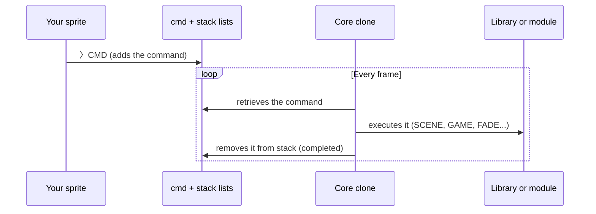

# 10 · Commands and Modules

> **Objective:** understand the **command** system that allows all sprites to communicate with each other, learn about the built-in commands, and **create your own commands**.

⬅️ [Scenes and Fades](<09 · Scenes and Fades.md>) · [Table of Contents](../README.md) · ➡️ [Data and Save Files](<11 · Data and Save Files.md>)

---

## 1. Why use commands?

In Scratch, making two sprites communicate requires broadcasting messages and passing values through variables. Catlib provides **a single block** to send any request to anyone:

```text
〉CMD / name [CMD] option [OPTION] args [ARG1] [ARG2] [ARG3] awaited? [AWAIT]
```

Example: "switch to the GAME scene" from any sprite:

```text
〉CMD / name [SCENE] option [SET] args [GAME] [] [] awaited? [NO]
```

## 2. Anatomy of a command

A command is a sentence: **NAME OPTION argument1 argument2 …**

| Part | Example | Purpose |
|---|---|---|
| `name` | `SCENE` | **Who** should handle it (the library or module). |
| `option` | `SET` | **What** to do. |
| `args` | `GAME` | The required **information**. |
| `awaited?` | `NO` | Whether to wait or not (see §4). |

Catlib joins these parts with spaces and adds `@` followed by a random 2-digit number to make the command unique (for example, `SCENE SET GAME@47`).

> [!TIP]
> To pass **more than 3 pieces of information**, put multiple values in the same field, separated by spaces: `args [20 20]`. When received, the words are separated by spaces.

> [!WARNING]
> Since spaces separate words, **an argument cannot contain spaces** (except for commands that join the remaining words together, such as `NOTE NEW`). Do not use the `@` character.

## 3. How a command works



1. `〉CMD` adds the command to two lists: `ᗢ CORE cmd` (pending commands) and `ᗢ CORE stack` (commands being processed).
2. **On every frame**, the Core loop creates **one** clone if there are pending commands.
3. This clone splits the command into words and checks the first one: the built-in library or the module responsible for handling it.
4. The command is removed from `stack`.

> [!NOTE]
> Only one command is executed **per frame**. If dozens of commands are sent at once, they will be processed one by one over a few frames.

## 4. To wait or not: `awaited?`

- `awaited? [NO]`: your script **continues immediately**.
- Any other value (including **empty**): your script **waits** until the command has been removed from `ᗢ CORE stack`.

> [!WARNING]
> "Completed" means **received and handled by Catlib**, not necessarily "fully executed". For `FADE`, the command is considered complete as soon as the module receives it, **before** the fade transition has finished. If you need to wait until a fade is complete, add a `wait` block with the desired duration.

## 5. Built-in commands

| Command | Options | Purpose | Chapter |
|---|---|---|---|
| `SCENE` | `SET`, `BACK`, `MAIN`, `SETMAIN`, `RESET` | Change scenes | [09](<09 · Scenes and Fades.md>) |
| `GAME` | `SET`, `GET`, `ADD`, `CREATE`, `UNSET`, `RENAME`, `CLEAR`, `FIND` | Game data | [11](<11 · Data and Save Files.md>) |
| `CACHE` | same as above | Temporary data | [11](<11 · Data and Save Files.md>) |
| `SAVE` | same as above + `IMPORT`, `EXPORT` | Save data | [11](<11 · Data and Save Files.md>) |
| `CLOUD` | same as above + `SYNC`, `SEND` | Cloud data | [11](<11 · Data and Save Files.md>) |
| `NOTE` | `NEW`, `OPEN`, `LIST`, `DEL` | Terminal notes | [12](<12 · The Built-in Terminal.md>) |
| `HELP` | — | Terminal help | [12](<12 · The Built-in Terminal.md>) |
| `TERMINAL` | `START` | Starts the terminal | [12](<12 · The Built-in Terminal.md>) |
| `KEY` | `START` | Starts keyboard input handling | [13](<13 · Sound, Keyboard, Mouse, and Time.md>) |
| `LOG` | `<TYPE> <text>` | Writes to the `〉LOGS` log | below |
| `FADE` | `<scene> …` | Scene transition with a fade (module) | [09](<09 · Scenes and Fades.md>) |

At startup, `Config - WHEN READY COMMANDS` automatically sends `TERMINAL START` and `KEY START`. This is where you can add your own startup commands.

### The `LOG` command

```text
〉CMD / name [LOG] option [INFO] args [The player has won] [] [] awaited? [NO]
```

Adds a line `HH:MM - [INFO] The player has won` to the beginning of the `〉LOGS` list. The type can be anything (`INFO`, `WARN`, etc.), except **`ERROR`**: it **stops the entire project** (`stop all`). Display the `〉LOGS` list (`show list` block) to read it.

## 6. Create **your own** commands with `Extension`

A **module** is a sprite that "subscribes" to a command name. The **`Extension`** sprite is the template to duplicate.

> *"DUPLICATE to make your own commands! CHANGE the name of your command here."* — comment in `Extension`

### Step by step: creating the `COIN` command

1. **Duplicate** the `Extension` sprite and rename it (for example, `Module COIN`).
2. In the `when I receive ᗢ CATLIB - ready` script, change the name: `〉MODULE set name / name [COIN]`.
3. Inside the **`ᗢ MODULE actions`** block, write what your command does, using `〉MEMORY / get` to read the command parts.
4. Test it from any sprite using a `〉CMD` block.

### Reading command parts: `〉MEMORY / get`

```text
〉MEMORY / get [INDEX] ( to [TO] )
```

The result is stored in the module's `ᗢ CORE memory` variable.

| `INDEX` | Contains |
|---|---|
| `1` | The command **name** (`COIN`) |
| `2` | The **option** |
| `3` | First **argument** |
| `4` | Second argument… |

If you fill in `to` (for example, `END`), the block **joins together** all words from `INDEX` to `TO`, separating them with spaces. `END` = up to the last word. If the index exceeds the number of words, the result is `NULL`.

### Example: a `COIN ADD 5` command

```text
DEFINE ᗢ MODULE actions
    〉MEMORY / get [2]                     ← the option
    if < ᗢ CORE memory = [ADD] > then
        〉MEMORY / get [3]                 ← the number of coins
        〉DATA / source [SAVE] action [ADD] var [COINS] to [ᗢ CORE memory]
```

Usage, from anywhere:

```text
〉CMD / name [COIN] option [ADD] args [5] [] [] awaited? [NO]
```

### The example included in `Extension`

In the template, the command is named `// CHANGE //` and provides two options for testing:

| Command | Result |
|---|---|
| `〉CMD name [// CHANGE //] option [TEST] args [hello world]` | Writes the **first word** after `TEST` to `〉LOGS`. |
| `〉CMD name [// CHANGE //] option [WORLD] args [hello world]` | Writes **the entire remaining text** (`hello world`) to `〉LOGS`. |

> [!NOTE]
> `// CHANGE //` is a **placeholder text**: until you give the module a real name (a single word, without spaces), these tests will not work.

The `ᗢ Fader +` module (the `FADE` command) is a complete example of a real module.

### How it works internally

1. At startup, your module announces its name (`〉MODULE set name`).
2. When Core receives a command it does not recognize, it copies its words into the `ᗢ CORE modules` list.
3. On each `tick`, every module checks whether the **first word** in this list matches its name. If it does, it creates a clone.
4. The clone copies the words into its own `ᗢ CORE memory` list, clears `ᗢ CORE modules`, executes `ᗢ MODULE actions`, and then disappears.

> [!WARNING]
> - Each module must have a **unique name**, different from the built-in commands (`SCENE`, `GAME`, `CACHE`, `SAVE`, `CLOUD`, `NOTE`, `HELP`, `TERMINAL`, `KEY`, `LOG`).
> - If no module has the requested name, **nothing happens and no error is displayed**. Check the spelling of the name.

---

⬅️ [Scenes and Fades](<09 · Scenes and Fades.md>) · [Table of Contents](../README.md) · ➡️ [Data and Save Files](<11 · Data and Save Files.md>)