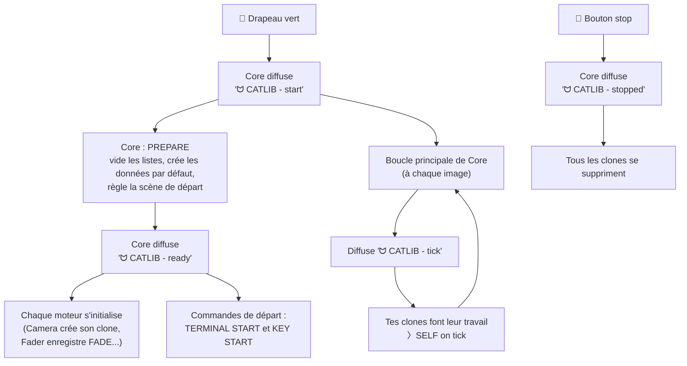
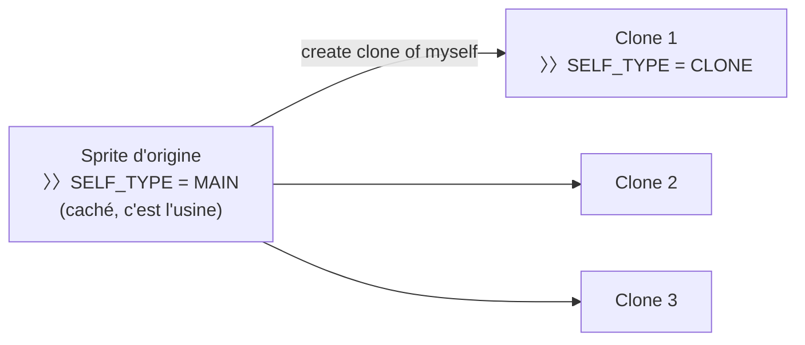
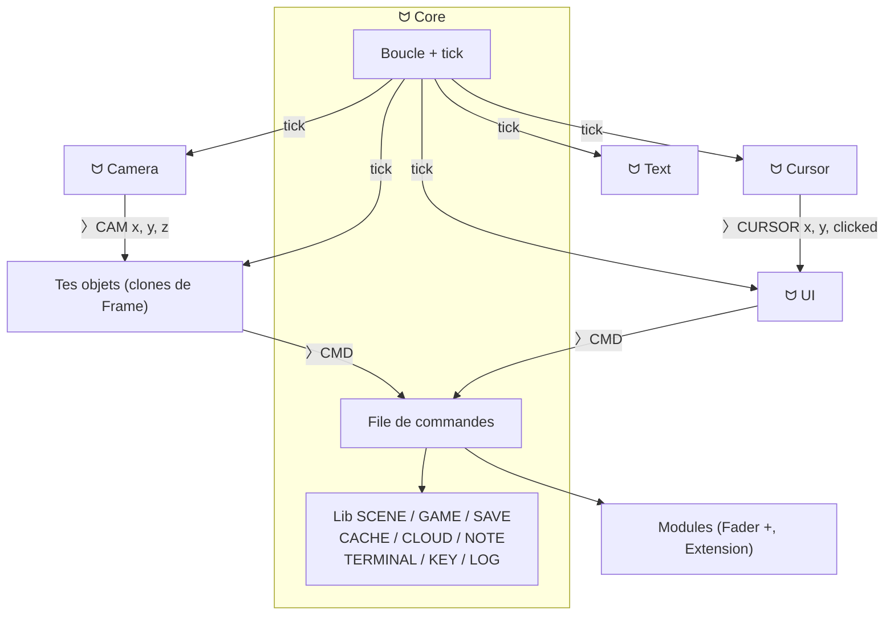

# 02 · Comment ça marche

> **Objectif :** comprendre le « cerveau » de Catlib. Une fois ce chapitre lu, tout le reste devient logique. Prends ton temps : c'est le chapitre le plus important.

⬅️ [Démarrage](01-demarrage.md) · [Sommaire](../README.md) · ➡️ [Le sprite Frame](03-frame.md)

---

## 1. Les trois idées à retenir

Catlib repose sur **trois idées** simples :

1. 📣 **Des messages** : `ᗢ Core` crie des messages (« c'est parti ! », « nouvelle image ! ») et tous les sprites écoutent.
2. 👯 **Des clones** : chaque objet du jeu est un **clone**. Le sprite d'origine ne sert qu'à en fabriquer.
3. 📋 **Des listes** : les données (sauvegardes, commandes, scènes…) sont rangées dans des **listes** globales.

## 2. Le cycle de vie : du drapeau vert à l'arrêt



### Le « battement de cœur » : le `tick`

Toutes les images (≈ 30 fois par seconde dans Scratch), `ᗢ Core` diffuse le message **`ᗢ CATLIB - tick`**. C'est le battement de cœur du jeu. Chaque clone qui l'entend exécute son bloc `〉SELF on tick` : *c'est là que tu mets tout ce qui doit se passer en continu* (déplacement, animation, vérification…).

> [!TIP]
> Dans un projet Scratch classique, on met un `répéter indéfiniment` dans chaque sprite. Avec Catlib, **on n'en met presque jamais** : le `tick` joue ce rôle, et tout le monde reste synchronisé.

### Ce que fait la boucle principale de Core à chaque image

| Étape | Effet |
|---|---|
| 1. S'il y a des commandes en attente | Crée **un clone** de Core qui exécute **une** commande (voir [10 · Commandes](10-commandes-modules.md)). |
| 2. `réinitialiser le chronomètre` | Sert à **détecter le bouton stop** (voir plus bas). |
| 3. `effacer tout` (stylo) | Efface le dessin de l'image précédente. |
| 4. `ᗢ CORE pack layers` | Met à jour l'ordre d'affichage des objets. |
| 5. `Func - DATE` et `Func - TIME` | Mettent à jour `〉TIME date` et `〉TIME clock`. |

Une **deuxième boucle** diffuse `ᗢ CATLIB - tick` et ajoute `0.1` à la variable `ᗢ CLOCK` (une horloge interne utilisée pour les identifiants uniques et pour le clignotement du curseur de texte).

> [!WARNING]
> **Le stylo est effacé à chaque image.** Si tu dessines avec le stylo toi-même, ton dessin disparaîtra aussitôt. Catlib utilise le stylo (par « tampon ») pour afficher les objets : c'est ce qui permet d'avoir de nombreux éléments sans ralentir. Voir [03 · Frame, mode tampon](03-frame.md#4-le-mode-tampon-stamp).

### Comment Catlib détecte le bouton stop

Scratch ne prévient pas quand on appuie sur stop. Catlib utilise une astuce : le chronomètre est remis à zéro **à chaque image** par la boucle de Core. Quand on appuie sur stop, la boucle s'arrête, le chronomètre se met à grimper, et le chapeau `quand chronomètre > 0` se déclenche. Il appelle `Config - ON STOP`, qui diffuse **`ᗢ CATLIB - stopped`**. Tous les clones l'écoutent et se suppriment : plus de clones fantômes après l'arrêt.

## 3. Les messages de Catlib

| Message | Envoyé par | Quand | Ce que tu en fais |
|---|---|---|---|
| `ᗢ CATLIB - start` | Core | Drapeau vert | Rien (c'est Core qui l'utilise). |
| `ᗢ CATLIB - ready` | Core | Tout est initialisé | Réinitialiser des variables au démarrage. |
| `ᗢ CATLIB - tick` | Core | **Chaque image** | Faire vivre les clones (déjà branché dans `Frame`). |
| `ᗢ CATLIB - vol changed` | À toi de l'envoyer | Après un changement de volume | Les sprites ré-appliquent leur volume (déjà branché). |
| `ᗢ CATLIB - stopped` | Core | Bouton stop | Les clones se suppriment (déjà branché). |
| `ᗢ CATLIB - first start` | Core | Nouvel utilisateur détecté | Lancer un tutoriel, une intro… |
| `ᗢ SCENE new` | Core | À chaque changement de scène | Réagir à n'importe quel changement. |
| `ᗢ SCENE back` | Core | Retour à la scène précédente | Idem. |
| `SCENE <NOM>` | Core | Entrée dans la scène `<NOM>` | **Créer les objets de cette scène.** |
| `SCENE <NOM> STOP` | Core | Changement de scène | Voir [09 · Scènes](09-scenes-fondus.md#attention--le-message-stop). |
| `INTRO fade` | INTRO V12 | Fin du logo | Utilisé uniquement par l'intro. |

> [!NOTE]
> Un autre message, `ᗢ - CATLIB init`, existe dans le projet mais **aucun script ne l'utilise**.

## 4. Sprite d'origine et clones

Tous les sprites basés sur `Frame` fonctionnent de la même manière :



- Le **sprite d'origine** a la variable `〉〉SELF_TYPE = MAIN`. Il est caché, et il reçoit `ᗢ CATLIB - ready` pour remettre ses variables à zéro.
- Chaque **clone** a `〉〉SELF_TYPE = CLONE`. Ce n'est qu'à ce moment qu'il reçoit un identifiant unique, un calque, et qu'il joue son `〉SELF on tick`.

> [!TIP]
> Les variables « pour ce sprite uniquement » (`〉SELF x`, `〉SELF y`, `〉FX ghost`…) sont **propres à chaque clone**. Chaque objet a donc sa position, sa taille et ses effets à lui.

## 5. Le principe « je prépare, puis je dessine »

Dans Catlib, un objet **ne se déplace pas directement** avec `aller à x: y:`. Il fait en deux temps :

```text
1) CALCULER   : les blocs 〉MOVE / 〉SIZE / 〉ROTATE / 〉FX modifient des variables
                (〉SELF x, 〉SELF y, 〉SELF size, 〉SELF rotation, 〉FX ghost…)
2) APPLIQUER  : 〉UPDATE normal  (ou 〉UPDATE camera)  copie ces variables
                sur le vrai sprite à l'écran.
```

C'est ce qui permet d'ajouter la caméra, les calques ou le zoom **sans changer ta logique** : il suffit de remplacer `〉UPDATE normal` par `〉UPDATE camera`.

## 6. Les variables et listes globales

Les variables et listes **globales** (visibles par tous les sprites) vivent sur la scène. Voici les plus importantes :

### Variables

| Variable | Contient |
|---|---|
| `〉SCENE` | Le nom de la scène actuelle (`MENU`, `GAME`…). |
| `〉TIME clock` | L'heure `HH:MM` (les deux-points clignotent chaque seconde). |
| `〉TIME date` | La date au format `MM/JJ/AAAA`. |
| `〉CAM x`, `〉CAM y`, `〉CAM z`, `〉CAM rotation` | La position, le zoom et la rotation de la caméra. |
| `〉CURSOR x`, `〉CURSOR y` | La position de la souris. |
| `〉CURSOR clicked ?` | `YES` ou `NO` : le bouton de la souris est-il enfoncé ? |
| `〉CURSOR hovering ?` | `YES` ou `NO` : le curseur survole-t-il un bouton ? |
| `〉USER` | Le dernier nom d'utilisateur Scratch vu (détecte le premier démarrage). |
| `☁ 〉CLOUD global` | La variable cloud. |

### Listes

| Liste | Contient |
|---|---|
| `ᗢ DATA game` / `save` / `cache` / `cloud` | Les 4 espaces de données ([chapitre 11](11-donnees-sauvegardes.md)). |
| `〉SAVECODES` | Les derniers codes de sauvegarde générés. |
| `〉PRESSED KEY` | Les touches actuellement enfoncées. |
| `ᗢ CORE cmd` / `stack` | La file d'attente des commandes. |
| `ᗢ CORE scenes` | L'historique des scènes. |
| `ᗢ CORE layers order` / `layers` | L'ordre d'affichage des objets. |
| `〉LOGS` | Le journal des messages `LOG`. |

## 7. Conventions de nommage

| Préfixe | Signification |
|---|---|
| `〉` | Bloc ou variable **destinés à l'utilisateur**. |
| `〉〉` | Variable globale propre à un sprite `Frame` (ex. `〉〉UNIQUE_ID`, `〉〉SELF_TYPE`). |
| `ᗢ CORE` | **Interne** : rouages de Catlib. |
| `Config - …` | Blocs de **configuration** dans `ᗢ Core`. |
| `Lib - …` | Les « bibliothèques » de commandes de `ᗢ Core` (`Lib - SCENE`, `Lib - SAVE`…). |
| `Func - …` | Fonctions internes de `ᗢ Core`. |

## 8. Schéma général : qui parle à qui ?



---

⬅️ [Démarrage](01-demarrage.md) · [Sommaire](../README.md) · ➡️ [Le sprite Frame](03-frame.md)
