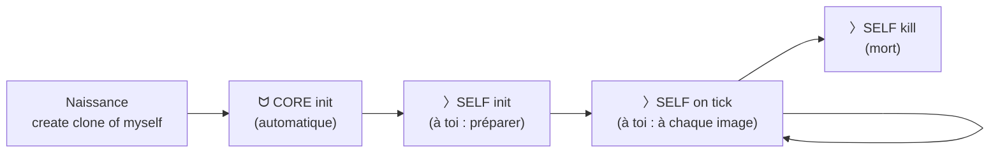

# 03 · Le sprite Frame

> **Objectif :** savoir fabriquer n'importe quel objet de ton jeu (personnage, décor, ennemi, bouton…) à partir du sprite **`Frame`**.

⬅️ [Comment ça marche](02-fonctionnement.md) · [Sommaire](../README.md) · ➡️ [Mouvements et effets](04-mouvements-effets.md)

---

## 1. À quoi sert Frame ?

`Frame` est le **moteur de base** : il contient déjà tout ce qu'il faut pour qu'un objet soit compatible avec Catlib (caméra, calques, effets, sons, commandes, outils…).

> Le commentaire collé sur `Frame` le dit : **« DUPLICATE THIS SPRITE. This is the base sprite you need to use as a starting point to be able to use Catlib's features. »**

Tu ne modifies **jamais** `Frame` lui-même : tu le **dupliques** (clic droit → *dupliquer*) et tu travailles sur la copie.

> [!TIP]
> Le sprite **`DEMO`** est une copie de `Frame` avec des **commentaires explicatifs**. Lis-le pour comprendre chaque bloc, puis duplique `Frame` pour travailler.

## 2. Les 4 vies d'un objet



### Naissance : `créer un clone de moi-même`

Pour faire apparaître un objet, on crée un clone du sprite. Un objet n'existe que quand tu le crées :

```text
quand je reçois [SCENE GAME]
créer un clone de [moi-même]
```

### Initialisation automatique : `ᗢ CORE init`

Dès qu'un clone naît, `Frame` exécute `ᗢ CORE init` (**ne le modifie pas**). Il fait, dans l'ordre :

1. Crée un **identifiant unique** (`〉〉UNIQUE_ID`, par exemple `4bwmakn04u-3ilxn1da3z-141`).
2. Règle `〉〉SOUND_SOURCE` sur `SFX`, `〉〉CLONE_TYPE` sur `FRAME`, `〉〉SELF_TYPE` sur `CLONE`.
3. Mémorise les **valeurs d'origine** (`〉SELF x origine`, `〉SELF y origine`, `〉SELF size origine`, `〉SELF sprite origine`).
4. Enregistre l'objet dans la liste des calques.
5. Met l'effet fantôme à 100 (**invisible**) et cache le sprite.
6. Appelle **`〉SELF init`**, puis **`〉SELF on tick`** une première fois.

### Préparation : `〉SELF init` (à toi)

> *« Use this to prepare instance before it get rendered. »* — commentaire de `DEMO`

C'est ici que tu règles **le point de départ** : position, taille, calque, costume, effets. Dans `Frame`, ce bloc contient par défaut :

```text
〉MOVE set / xy [0] [0]
〉SIZE set / val [40]
〉SELF set layer / layer [100]
〉FX ghost / val [100] speed [1]
afficher
```

> [!WARNING]
> **Ton objet est invisible par défaut** : `〉FX ghost val 100` signifie « fantôme à 100 % ». Pour le faire apparaître, mets par exemple `〉FX ghost / val [0] speed [5]` (apparition en douceur) dans `〉SELF init` ou `〉SELF on tick`.

### À chaque image : `〉SELF on tick` (à toi)

C'est ta **boucle** d'objet. Elle est appelée à chaque `ᗢ CATLIB - tick`, **uniquement pour les clones**. Par défaut :

```text
〉UPDATE normal
```

Tu y ajoutes tes mouvements, tes effets, tes conditions. **Règle importante : `〉UPDATE normal` (ou `〉UPDATE camera`) doit rester à la fin**, car c'est lui qui applique tout à l'écran (voir ci-dessous).

### Mort : `〉SELF kill`

> *« Don't use [delete this clone] to kill an instance. USE THIS → [〉SELF kill] »* — commentaire de `DEMO`

`〉SELF kill` retire l'objet de la liste des calques **avant** de supprimer le clone. Si tu supprimes un clone sans lui, la liste des calques garde un « fantôme » et l'ordre d'affichage se dérègle. C'est aussi ce bloc qui est appelé automatiquement à l'arrêt du projet.

## 3. Appliquer à l'écran : `〉UPDATE`

Les blocs `〉MOVE`, `〉SIZE`, `〉ROTATE` ne déplacent **pas** le sprite : ils modifient des variables (`〉SELF x`, `〉SELF y`, `〉SELF size`, `〉SELF rotation`). C'est `〉UPDATE` qui les **applique** au vrai sprite.

| Bloc | Rôle |
|---|---|
| `〉UPDATE normal` | Mode **normal** : l'objet se comporte comme d'habitude. Il n'est pas influencé par la caméra (idéal pour l'interface). |
| `〉UPDATE camera / origine [ORIGINE] mirror [SIDE]` | Mode **caméra** : l'objet est lié à la caméra (position, zoom, rotation). Voir [05 · Caméra](05-camera.md). |

Ces deux blocs mettent aussi à jour le calque (`ᗢ CORE update plan`) et la taille (`ᗢ CORE size instant`, qui permet de dépasser la limite de taille de Scratch en passant par un costume vide `_BLANK`).

> [!NOTE]
> Une rotation de `0` signifie « droit » : Catlib fait `s'orienter à (rotation + 90)` pour toi. Une rotation positive tourne dans le sens des aiguilles d'une montre.

## 4. Le mode tampon (stamp)

> *« STAMP: When used the sprite will only be rendered with stamp. »* — commentaire de `DEMO`

Avec `〉SELF stamp`, au lieu d'afficher le vrai sprite, Catlib le **tamponne** avec le stylo puis le rend **invisible** (fantôme 100). L'image restante vient du stylo, que Core **efface à chaque image**.

```text
quand je reçois [ᗢ CATLIB - tick]  →  〉SELF on tick :
    …tes mouvements…
    〉UPDATE normal
    〉SELF stamp
```

**Avantages :** beaucoup d'éléments (comme les lettres du texte) sans ralentir, et l'effet fantôme / luminosité s'applique au tampon.
**À savoir :** le tampon doit être refait **à chaque image**, sinon l'objet disparaît à la suivante. C'est ce qu'utilisent le curseur, l'UI et le texte de Catlib.

## 5. Les calques (ordre d'affichage)

Quel objet passe devant quel autre ? C'est le rôle de :

```text
〉SELF set layer / layer [LAYER]
```

> *« 5 - 10000. The bigger, the more in front. »* — commentaire de `DEMO`

| Valeur | Effet |
|---|---|
| un nombre (ex. `100`) | Plus le nombre est **grand**, plus l'objet est **devant**. |
| `TOP` | Tout devant. |
| `BOTTOM` | Tout derrière. |

La variable `〉SELF layer` te dit la position actuelle de l'objet.

> [!TIP]
> Donne à tes objets des valeurs **différentes** et régulièrement espacées (décor `10`, personnages `100`, effets `500`, interface `1000`). Ça te laisse la place d'insérer d'autres couches plus tard.

> [!NOTE]
> D'après le code, la liste des calques est agrandie jusqu'au numéro demandé (des cases vides sont ajoutées). Évite donc des valeurs énormes inutiles.

## 6. Ce que Frame t'offre

Chaque sprite dupliqué de `Frame` reçoit **gratuitement** :

| Famille | Blocs | Chapitre |
|---|---|---|
| Déplacement | `〉MOVE set / smooth / bounce / add`, `〉MOVE+ parallax` | [04](04-mouvements-effets.md) |
| Taille | `〉SIZE set / smooth / bounce / add`, `〉SIZE+ mouse speed` | [04](04-mouvements-effets.md) |
| Rotation | `〉ROTATE set / smooth / bounce / add`, `〉ROTATE+ mouse speed` | [04](04-mouvements-effets.md) |
| Effets | `〉FX ghost / bright / color / fisheye / pixalate / whirl` | [04](04-mouvements-effets.md) |
| Rendu | `〉UPDATE normal`, `〉UPDATE camera`, `〉SELF stamp`, `〉SELF set layer` | ce chapitre + [05](05-camera.md) |
| Données | `〉DATA / source action var to` | [11](11-donnees-sauvegardes.md) |
| Commandes | `〉CMD / name option args…` | [10](10-commandes-modules.md) |
| Son | `〉SOUND play`, `〉SOUND stop` | [13](13-son-clavier-temps.md) |
| Outils | `〉TOOL …` (distance, angle, collision, texte…) | [14](14-tools.md) |

### Les variables de chaque objet

| Variable | Rôle |
|---|---|
| `〉SELF x`, `〉SELF y` | Position voulue. |
| `〉SELF size` | Taille voulue (en %). |
| `〉SELF rotation` | Rotation voulue (en degrés). |
| `〉SELF layer` | Position dans les calques. |
| `〉SELF x origine`, `y origine`, `size origine`, `sprite origine` | Valeurs au moment de la naissance. |
| `〉FX ghost`, `bright`, `color`, `fisheye`, `pixel`, `whirl` | Valeurs actuelles des effets. |
| `〉〉UNIQUE_ID` | Identifiant unique du clone. |
| `〉〉SELF_TYPE` | `MAIN` (sprite d'origine) ou `CLONE`. |
| `〉〉CLONE_TYPE` | Type d'objet (`FRAME` par défaut). |
| `〉〉SOUND_SOURCE` | Canal sonore (`SFX` par défaut, ou `MUSIC`…). |

## 7. Le script d'exemple dans Frame (à supprimer !)

`Frame` et `DEMO` contiennent chacun un petit script d'**exemple** :

```text
quand je commence comme un clone
répéter indéfiniment
    〉MOVE bounce / xy [0] [0] damp [2] bounciness [2]
    〉SIZE bounce / val [40] damp [2] bounce [2]
```

Il ramène l'objet au centre avec un effet rebondissant. C'est très bien pour **voir** comment ça marche, mais **supprime-le dans tes propres sprites**, sinon chacun de tes clones sera ramené au centre en permanence !

## 8. Checklist : créer un objet

1. ✅ Dupliquer `Frame`, renommer la copie.
2. ✅ Ajouter tes **costumes** (garde `Icon` et `_BLANK`, utilisés par Catlib).
3. ✅ **Supprimer** le script d'exemple (§7).
4. ✅ Remplir `〉SELF init` (position, taille, calque, apparition).
5. ✅ Remplir `〉SELF on tick` (logique), en gardant `〉UPDATE normal` à la fin.
6. ✅ Créer l'objet quand il le faut : `créer un clone de moi-même`.
7. ✅ Le supprimer avec `〉SELF kill`.

👉 Un exemple complet : [Recette 1 : Mon premier objet](15-recettes.md#recette-1--mon-premier-objet).

---

⬅️ [Comment ça marche](02-fonctionnement.md) · [Sommaire](../README.md) · ➡️ [Mouvements et effets](04-mouvements-effets.md)
