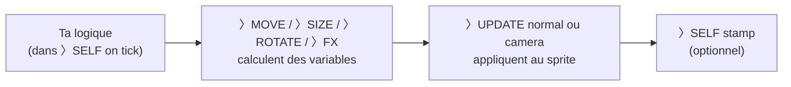

# 04 · Mouvements et effets

> **Objectif :** animer tes objets en douceur (glisser, rebondir, grossir, tourner) et leur appliquer des effets visuels, avec les blocs `〉MOVE`, `〉SIZE`, `〉ROTATE` et `〉FX`.

⬅️ [Frame](03-frame.md) · [Sommaire](../README.md) · ➡️ [Caméra](05-camera.md)

---

## 1. Le principe : viser une cible

Tous ces blocs fonctionnent pareil : tu donnes **où tu veux aller** (la cible), et le bloc **rapproche un peu** l'objet de la cible **à chaque appel**. Appelés à chaque image dans `〉SELF on tick`, ils créent une animation fluide.

```text
〉SELF on tick :
    〉MOVE smooth / xy [100] [50] damp [8]
    〉UPDATE normal
```

> [!WARNING]
> Ces blocs ne font **qu'un petit pas à la fois**. Il faut donc les **appeler à chaque tick** (dans `〉SELF on tick`), pas une seule fois.

## 2. Les 4 « façons de bouger »

Pour chaque grandeur (position, taille, rotation), il y a la même famille de blocs :

| Bloc | Comportement | Quand l'utiliser |
|---|---|---|
| **`set`** | **Instantané** : l'objet saute à la valeur. | Placer un objet au départ. |
| **`smooth`** | **Glisse** vers la cible en ralentissant à l'arrivée. | Déplacements doux. |
| **`bounce`** | Va vers la cible comme **attaché à un ressort** : dépasse, revient, se stabilise. | Boutons, menus, effets « vivants ». |
| **`add`** | **Ajoute** une valeur à la valeur actuelle. | Mouvement relatif (+2 à chaque image). |

### `smooth` : `〉MOVE smooth / xy [X] [Y] damp [DAMP]`

À chaque appel, l'objet parcourt `1/DAMP` de la distance qui le sépare de la cible.

| `damp` | Effet |
|---|---|
| `1` | Instantané (c'est exactement ce que fait `set`). |
| `2` à `5` | Rapide. |
| `8` à `20` | Lent et doux (caméra, suivi). |

### `bounce` : `〉MOVE bounce / xy [X] [Y] damp [DAMP] bounciness [BOUNCE]`

Ici, l'objet a une **vitesse** qui s'ajoute à sa position. À chaque image :

```text
vitesse = vitesse / BOUNCE  +  (cible − position) / DAMP
position = position + vitesse
```

| Paramètre | Rôle | Astuce |
|---|---|---|
| `damp` | Force du « ressort » : plus c'est **petit**, plus l'objet est tiré fort. | Commence avec `2`. |
| `bounciness` | Garde de la vitesse d'une image à l'autre. | **Contre-intuitif :** plus la valeur est proche de `1`, plus ça rebondit longtemps. Avec `2`, le mouvement s'amortit vite. En dessous de `1`, ça devient instable. |

> [!TIP]
> Les valeurs `damp = 2` et `bounciness = 2` sont celles utilisées par le curseur et par les boutons de Catlib : ce sont de bons réglages de départ.

## 3. Le déplacement : `〉MOVE`

| Bloc | Rôle |
|---|---|
| `〉MOVE set / xy [X] [Y]` | Place l'objet **tout de suite**. |
| `〉MOVE smooth / xy [X] [Y] damp [DAMP]` | Glisse vers `(X ; Y)`. |
| `〉MOVE bounce / xy [X] [Y] damp [DAMP] bounciness [BOUNCE]` | Rebondit vers `(X ; Y)`. |
| `〉MOVE add / xy [X] [Y]` | Ajoute `X` et `Y` à la position. |
| `〉MOVE+ parallax / damp [DAMP] for [X/Y]` | Fait **réagir l'objet à la souris** (voir §6). |

> [!TIP]
> **Laisser une case vide**, c'est « ne pas toucher à cet axe ». `〉MOVE smooth / xy [] [50] damp [5]` ne modifie que `y`. Utile pour ne contrôler qu'un seul axe (par exemple, un personnage qui se déplace à gauche/droite mais dont la hauteur est gérée ailleurs).

## 4. La taille : `〉SIZE`

| Bloc | Rôle |
|---|---|
| `〉SIZE set / val [VALUE]` | Taille immédiate (en %). |
| `〉SIZE smooth / val [VALUE] damp [DAMP]` | Grossit / rétrécit en douceur. |
| `〉SIZE bounce / val [VALUE] damp [DAMP] bounce [BOUNCE]` | Effet « ressort » sur la taille (un bouton qui pulse). |
| `〉SIZE add / val [VAL]` | Ajoute à la taille. |
| `〉SIZE+ mouse speed / damp [DAMP]` | La taille réagit à la **vitesse de la souris** (voir §6). |

## 5. La rotation : `〉ROTATE`

| Bloc | Rôle |
|---|---|
| `〉ROTATE set / val [VAL]` | Rotation immédiate (degrés). |
| `〉ROTATE smooth / val [VALUE] damp [DAMP]` | Tourne en douceur. |
| `〉ROTATE bounce / val [VALUE] damp [DAMP] bounce [BOUNCE]` | Tourne avec un effet ressort. |
| `〉ROTATE add / val [VALUE]` | Ajoute des degrés (ex. `+2` à chaque image = toupie). |
| `〉ROTATE+ mouse speed / damp [DAMP] mirror [MIRROR]` | La rotation réagit à la **vitesse de la souris** (voir §6). |

## 6. Les animations qui réagissent à la souris

Trois blocs « `+` » ajoutent un **décalage** calculé à partir de la souris. Ils se placent **avant** le `smooth` / `bounce` correspondant.

| Bloc | Formule | Effet |
|---|---|---|
| `〉MOVE+ parallax / damp [DAMP] for [X/Y]` | décalage = `〉CURSOR x` ÷ `damp` (et/ou `y`) | L'objet se déplace **à l'opposé** de la souris : effet de profondeur. `for` : `X`, `Y` ou `XY`. |
| `〉SIZE+ mouse speed / damp [DAMP]` | décalage = `abs(〉CURSOR speed x)` ÷ `damp` × zoom | La taille augmente quand la souris va vite. |
| `〉ROTATE+ mouse speed / damp [DAMP] mirror [MIRROR]` | décalage = `〉CURSOR speed x` × `mirror` ÷ `damp` × zoom | L'objet penche selon la vitesse horizontale de la souris. `mirror` : `1` ou `-1` pour choisir le sens. |

**Exemple : un logo qui bouge avec la souris**

```text
〉SELF on tick :
    〉MOVE+ parallax / damp [40] for [XY]
    〉MOVE bounce / xy [0] [0] damp [2] bounciness [2]
    〉UPDATE normal
```

> [!WARNING]
> `〉SIZE+ mouse speed` et `〉ROTATE+ mouse speed` lisent la variable **`〉CURSOR speed x`**. Dans le fichier fourni, **aucun script ne met cette variable à jour** : elle reste à `0`, donc ces deux effets ne font rien tant que tu ne l'alimentes pas. Solution simple dans [06 · Curseur](06-curseur.md#5-alimenter-la-vitesse-de-la-souris). `〉MOVE+ parallax`, lui, fonctionne tout de suite (il utilise `〉CURSOR x` et `〉CURSOR y`, qui sont bien mis à jour).

> [!NOTE]
> Chaque famille garde en interne sa propre « vitesse » (une variable par axe). **N'utilise pas `smooth` et `bounce` en même temps sur la même grandeur** dans un même objet : ils se contrarieraient.

## 7. Les effets visuels : `〉FX`

Même principe de « glissement vers une cible », mais pour les effets graphiques de Scratch :

```text
〉FX ghost / val [VALUE] speed [SPEED]
```

| Bloc | Effet Scratch | Plage utile |
|---|---|---|
| `〉FX ghost` | fantôme (transparence) | `0` = visible, `100` = invisible |
| `〉FX bright` | luminosité | `-100` à `100` |
| `〉FX color` | couleur (teinte) | `0` à `200` (boucle) |
| `〉FX fisheye` | œil de poisson | valeurs positives = déformation |
| `〉FX pixalate` | pixellisation | `0` et plus |
| `〉FX whirl` | tourbillon | positif ou négatif |

`speed` joue le même rôle que `damp` : `1` = tout de suite, plus grand = plus lent.

**Exemples**

```text
〉FX ghost / val [0] speed [5]        ← apparition en fondu
〉FX ghost / val [100] speed [5]      ← disparition en fondu
〉FX bright / val [30] speed [1]      ← éclaircir d'un coup
```

> [!NOTE]
> Les valeurs actuelles sont stockées dans `〉FX ghost`, `〉FX bright`, `〉FX color`, `〉FX fisheye`, `〉FX pixel` et `〉FX whirl`, **propres à chaque clone**. En mode tampon, appelle tes `〉FX` **avant** `〉SELF stamp`.

## 8. Récapitulatif visuel



---

⬅️ [Frame](03-frame.md) · [Sommaire](../README.md) · ➡️ [Caméra](05-camera.md)
