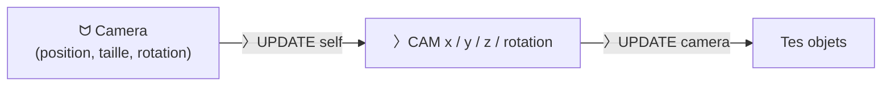

# 05 · Caméra

> **Objectif :** déplacer, zoomer et faire tourner la « caméra » du jeu, et faire en sorte que tes objets la suivent.

⬅️ [Mouvements et effets](04-mouvements-effets.md) · [Sommaire](../README.md) · ➡️ [Curseur](06-curseur.md)

---

## 1. Le principe

Dans Scratch, il n'y a pas de vraie caméra. Catlib en simule une : au lieu de déplacer la caméra, il **déplace tous les objets dans le sens inverse**, avec un peu de calcul. Tu n'as pas à faire ces calculs.

Il y a trois acteurs :

| Acteur | Rôle |
|---|---|
| Le sprite **`ᗢ Camera`** | Un sprite construit comme `Frame`. Sa position, sa taille et sa rotation **sont** celles de la caméra. |
| Les variables **`〉CAM x`, `〉CAM y`, `〉CAM z`, `〉CAM rotation`** | Les valeurs de la caméra, lisibles par tous. |
| Le bloc **`〉UPDATE camera`** | Utilisé par tes objets pour **obéir** à la caméra. |



Dans `ᗢ Camera`, le bloc `〉UPDATE self` fait : `〉CAM x = 〉SELF x`, `〉CAM y = 〉SELF y`, `〉CAM rotation = 〉SELF rotation`, `〉CAM z = 〉SELF size ÷ 100`.

> **Zoom :** la taille de la caméra est son zoom. Taille `100` = zoom ×1 (normal), `200` = ×2 (tout est deux fois plus gros).

## 2. Bouger la caméra : le bloc `UPADTE CAM`

> *« HERE you can change the camera position. IF your sprites use the UPDATE CAMERA block they will move as the camera moves. »* — commentaire dans `ᗢ Camera`

Dans `ᗢ Camera`, cherche le bloc **`UPADTE CAM`** (oui, avec cette faute de frappe : garde le nom tel quel). Il est exécuté **à chaque image** et contient par défaut :

```text
DEFINE UPADTE CAM
    〉SIZE set / val [100]
    〉MOVE set / xy [0] [0]
```

= caméra fixe au centre, zoom normal. **C'est ici que tu mets ta logique de caméra**, avec les mêmes blocs que pour n'importe quel objet (voir [04](04-mouvements-effets.md)).

### Exemple : suivre un joueur en douceur

```text
DEFINE UPADTE CAM
    〉SIZE set / val [100]
    〉MOVE bounce / xy [(x position) of [Joueur]] [(y position) of [Joueur]] damp [8] bounciness [2]
```

### Exemple : zoom avec une touche

```text
DEFINE UPADTE CAM
    si <touche [flèche haut] pressée ?> alors
        〉SIZE smooth / val [150] damp [10]
    sinon
        〉SIZE smooth / val [100] damp [10]
    〉MOVE set / xy [0] [0]
```

### Exemple : légère rotation

```text
    〉ROTATE smooth / val [10] damp [20]
```

> [!TIP]
> Si ton décor part dans le **mauvais sens**, c'est un simple problème de signe. Soit tu changes `mirror` (voir plus bas), soit tu donnes la position **opposée** à la caméra (par exemple `0 − x` du joueur).

## 3. Faire obéir un objet à la caméra : `〉UPDATE camera`

Dans le `〉SELF on tick` de ton objet, **remplace** `〉UPDATE normal` par :

```text
〉UPDATE camera / origine [] mirror [1]
```

> *« CAMERA: The instance will behave like usual but it's linked to the camera position. »* — commentaire de `DEMO`

| Entrée | Rôle |
|---|---|
| `origine` | Centre de rotation. Valeur **`SELF`** (ou vide) : l'objet tourne autour de **lui-même**. Valeur **`CAMERA`** : il tourne autour du **centre de la caméra**. |
| `mirror` | `1` ou `-1` : le **sens** dans lequel l'objet réagit au mouvement de la caméra. |

Concrètement, voici ce que calcule `〉UPDATE camera` quand `origine` n'est pas `CAMERA` :

```text
position écran = ( position tournée par 〉CAM rotation  +  〉CAM x ÷ mirror ) × 〉CAM z
taille écran   = 〉SELF size × 〉CAM z
direction      = ( (〉CAM rotation + 〉SELF rotation) × (−mirror) ) + 90
```

Donc avec **`mirror = 1`**, l'objet est décalé de `+〉CAM x` ; avec **`mirror = -1`**, de `−〉CAM x`.

> [!WARNING]
> Le commentaire de `DEMO` annonce qu'avec `mirror = 1` « si la caméra va à droite, le sprite va à gauche » (`50 − 80 × mirror`). Or la formule du bloc fait l'inverse (`+ 80`). Selon la façon dont tu déplaces la caméra, il faudra donc `1` ou `-1` : **fais un test rapide** et garde le signe qui marche pour toi. Voir [17 · Limites connues](17-depannage.md).

### Quels objets doivent suivre la caméra ?

| Type d'objet | Mode conseillé |
|---|---|
| Décor, personnages, ennemis, projectiles (le « monde ») | `〉UPDATE camera` |
| Interface fixe (score, vies, boutons de menu) | `〉UPDATE normal` |
| Texte du jeu | `〉UPDATE normal` par défaut ; voir [08 · Texte](08-texte.md#6-suivre-la-caméra) pour suivre la caméra |

> [!NOTE]
> **Astuce expérimentale :** `mirror` est aussi un diviseur. Avec `2` ou `4`, l'objet suit la caméra **deux ou quatre fois moins** : idéal pour un arrière-plan lointain (effet de profondeur). Attention, cette valeur modifie aussi la rotation de l'objet.

## 4. Lire la caméra depuis ton code

Tu peux utiliser les variables globales dans n'importe quel sprite :

```text
si < 〉CAM z > [2] > alors … (la caméra est très zoomée)
```

---

⬅️ [Mouvements et effets](04-mouvements-effets.md) · [Sommaire](../README.md) · ➡️ [Curseur](06-curseur.md)
