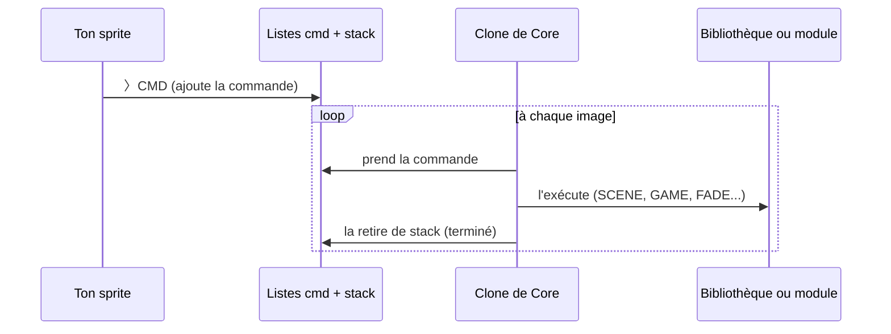

# 10 · Commandes et modules

> **Objectif :** comprendre le système de **commandes** qui permet à tous les sprites de se parler, connaître les commandes intégrées, et **créer tes propres commandes**.

⬅️ [Scènes et fondus](09-scenes-fondus.md) · [Sommaire](../README.md) · ➡️ [Données et sauvegardes](11-donnees-sauvegardes.md)

---

## 1. Pourquoi des commandes ?

Dans Scratch, faire parler deux sprites demande de diffuser des messages et de passer des valeurs par des variables. Catlib propose **un seul bloc** pour tout demander à n'importe qui :

```text
〉CMD / name [CMD] option [OPTION] args [ARG1] [ARG2] [ARG3] awaited? [AWAIT]
```

Exemple : « va à la scène GAME » depuis n'importe quel sprite :

```text
〉CMD / name [SCENE] option [SET] args [GAME] [] [] awaited? [NO]
```

## 2. Anatomie d'une commande

Une commande est une phrase : **NOM OPTION argument1 argument2 …**

| Partie | Exemple | Rôle |
|---|---|---|
| `name` | `SCENE` | **Qui** doit s'en occuper (la bibliothèque ou le module). |
| `option` | `SET` | **Quoi** faire. |
| `args` | `GAME` | Les **informations** nécessaires. |
| `awaited?` | `NO` | Attendre ou non (voir §4). |

Catlib colle ces morceaux avec des espaces et ajoute `@` plus un nombre aléatoire à 2 chiffres pour rendre la commande unique (par exemple `SCENE SET GAME@47`).

> [!TIP]
> Pour passer **plus de 3 informations**, mets plusieurs valeurs dans une même case séparées par des espaces : `args [20 20]`. À l'arrivée, les mots sont séparés par les espaces.

> [!WARNING]
> Puisque les espaces séparent les mots, **un argument ne peut pas contenir d'espace** (sauf pour les commandes qui recollent la fin, comme `NOTE NEW`). N'utilise pas le caractère `@`.

## 3. Le trajet d'une commande



1. `〉CMD` ajoute la commande dans deux listes : `ᗢ CORE cmd` (à faire) et `ᗢ CORE stack` (en cours).
2. À **chaque image**, la boucle de Core crée **un** clone s'il y a des commandes en attente.
3. Ce clone découpe la commande en mots et regarde le premier : c'est la bibliothèque intégrée ou le module qui la traite.
4. La commande est retirée de `stack`.

> [!NOTE]
> Une seule commande est exécutée **par image**. Pour des dizaines de commandes en même temps, elles seront traitées une à une, en quelques images.

## 4. Attendre ou non : `awaited?`

- `awaited? [NO]` : ton script **continue tout de suite**.
- Toute autre valeur (y compris **vide**) : ton script **attend** que la commande soit sortie de `ᗢ CORE stack`.

> [!WARNING]
> « Terminé » veut dire **prise en charge par Catlib**, pas forcément « entièrement exécutée ». Pour `FADE`, la commande est considérée finie dès que le module l'a reçue, **avant** la fin du fondu. Si tu dois attendre la fin d'un fondu, ajoute un `attendre` avec la durée voulue.

## 5. Les commandes intégrées

| Commande | Options | Rôle | Chapitre |
|---|---|---|---|
| `SCENE` | `SET`, `BACK`, `MAIN`, `SETMAIN`, `RESET` | Changer de scène | [09](09-scenes-fondus.md) |
| `GAME` | `SET`, `GET`, `ADD`, `CREATE`, `UNSET`, `RENAME`, `CLEAR`, `FIND` | Données du jeu | [11](11-donnees-sauvegardes.md) |
| `CACHE` | idem | Données temporaires | [11](11-donnees-sauvegardes.md) |
| `SAVE` | idem + `IMPORT`, `EXPORT` | Données de sauvegarde | [11](11-donnees-sauvegardes.md) |
| `CLOUD` | idem + `SYNC`, `SEND` | Données cloud | [11](11-donnees-sauvegardes.md) |
| `NOTE` | `NEW`, `OPEN`, `LIST`, `DEL` | Notes du terminal | [12](12-terminal.md) |
| `HELP` | — | Aide du terminal | [12](12-terminal.md) |
| `TERMINAL` | `START` | Lance le terminal | [12](12-terminal.md) |
| `KEY` | `START` | Lance la lecture du clavier | [13](13-son-clavier-temps.md) |
| `LOG` | `<TYPE> <texte>` | Écrit dans le journal `〉LOGS` | ci-dessous |
| `FADE` | `<scène> …` | Fondu entre scènes (module) | [09](09-scenes-fondus.md) |

Au démarrage, `Config - WHEN READY COMMANDS` envoie automatiquement `TERMINAL START` et `KEY START`. C'est l'endroit pour ajouter tes propres commandes de lancement.

### La commande `LOG`

```text
〉CMD / name [LOG] option [INFO] args [Le joueur a gagné] [] [] awaited? [NO]
```
Ajoute en tête de la liste `〉LOGS` une ligne `HH:MM - [INFO] Le joueur a gagné`. Le type est libre (`INFO`, `WARN`…), sauf **`ERROR`** : il **arrête tout le projet** (`stop all`). Affiche la liste `〉LOGS` (bloc *montrer la liste*) pour la lire.

## 6. Créer **tes propres** commandes avec `Extension`

Un **module** est un sprite qui « s'abonne » à un nom de commande. Le sprite **`Extension`** est le modèle à dupliquer.

> *« DUPLICATE to make your own commands! CHANGE the name of your command here. »* — commentaire dans `Extension`

### Étape par étape : créer la commande `COIN`

1. **Dupliquer** le sprite `Extension`, le renommer (par exemple `Module COIN`).
2. Dans le script `quand je reçois ᗢ CATLIB - ready`, change le nom : `〉MODULE set name / name [COIN]`.
3. Dans le bloc **`ᗢ MODULE actions`**, écris ce que fait ta commande, en lisant les morceaux avec `〉MEMORY / get`.
4. Teste depuis n'importe quel sprite avec un bloc `〉CMD`.

### Lire les morceaux : `〉MEMORY / get`

```text
〉MEMORY / get [INDEX] ( to [TO] )
```

Le résultat est placé dans la variable `ᗢ CORE memory` du module.

| `INDEX` | Contient |
|---|---|
| `1` | Le **nom** de la commande (`COIN`) |
| `2` | L'**option** |
| `3` | Premier **argument** |
| `4` | Deuxième argument… |

Si tu remplis `to` (par exemple `END`), le bloc **recolle** tous les mots de `INDEX` jusqu'à `TO` en les séparant par un espace. `END` = jusqu'au dernier mot. Si le numéro dépasse le nombre de mots, le résultat est `NULL`.

### Exemple : une commande `COIN ADD 5`

```text
DEFINE ᗢ MODULE actions
    〉MEMORY / get [2]                     ← l'option
    si < ᗢ CORE memory = [ADD] > alors
        〉MEMORY / get [3]                 ← le nombre de pièces
        〉DATA / source [SAVE] action [ADD] var [COINS] to [ᗢ CORE memory]
```

Utilisation, depuis n'importe où :

```text
〉CMD / name [COIN] option [ADD] args [5] [] [] awaited? [NO]
```

### L'exemple fourni dans `Extension`

Dans le modèle, la commande s'appelle `// CHANGE //` et propose deux options pour tester :

| Commande | Résultat |
|---|---|
| `〉CMD name [// CHANGE //] option [TEST] args [hello world]` | Écrit dans `〉LOGS` le **premier mot** après `TEST`. |
| `〉CMD name [// CHANGE //] option [WORLD] args [hello world]` | Écrit dans `〉LOGS` **toute la suite** (`hello world`). |

> [!NOTE]
> `// CHANGE //` est un **texte à remplacer** : tant que tu n'as pas donné un vrai nom (un mot, sans espace) au module, ces tests ne peuvent pas fonctionner.

Le module `ᗢ Fader +` (commande `FADE`) est un exemple complet de module réel.

### Comment ça marche en interne

1. Au démarrage, ton module annonce son nom (`〉MODULE set name`).
2. Quand Core reçoit une commande qu'il ne connaît pas, il copie ses mots dans la liste `ᗢ CORE modules`.
3. À chaque `tick`, chaque module regarde si le **premier mot** de cette liste est son nom. Si oui, il crée un clone.
4. Le clone copie les mots dans sa propre liste `ᗢ CORE memory`, vide `ᗢ CORE modules`, exécute `ᗢ MODULE actions`, puis disparaît.

> [!WARNING]
> - Chaque module doit avoir un **nom unique**, différent des commandes intégrées (`SCENE`, `GAME`, `CACHE`, `SAVE`, `CLOUD`, `NOTE`, `HELP`, `TERMINAL`, `KEY`, `LOG`).
> - Si aucun module ne porte le nom demandé, **rien ne se passe et aucune erreur n'est affichée**. Vérifie l'orthographe du nom.

---

⬅️ [Scènes et fondus](09-scenes-fondus.md) · [Sommaire](../README.md) · ➡️ [Données et sauvegardes](11-donnees-sauvegardes.md)
